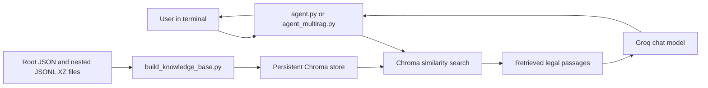

# Kuku — Legal Research Assistant

Kuku is a local command-line retrieval-augmented generation (RAG) prototype for exploring Indian legal materials. It indexes legal JSON and compressed JSONL datasets into a persistent Chroma vector store, retrieves relevant passages for a question, and asks a Groq-hosted language model to produce a cautious, evidence-grounded response.

The project is intended for experimentation and general legal information. It is not a lawyer, does not guarantee completeness or correctness, and should not be used as a substitute for qualified legal advice.

## What it does

- Builds a searchable local knowledge base from JSON files in the project root and `.jsonl.xz` files nested in dataset folders.
- Splits source material into overlapping chunks and stores them in Chroma for semantic retrieval.
- Offers two interactive CLI entry points: iterative retrieval (`agent.py`) and multi-query retrieval (`agent_multirag.py`).
- Sends retrieved context and the question to Groq; the prompts instruct the model to avoid unsupported legal claims and identify uncertainty.
- Keeps conversation history in memory for the current process.

## How a question is answered



## Requirements

- Python 3.10 or newer is recommended.
- A Groq API key with access to at least one configured model.
- A legally authorized JSON/JSONL.XZ corpus placed locally in the project root or nested folders. Kuku's assignment input pack is excluded from this public repository and must not be published or shared.
- Disk space for the generated Chroma vector database, which can be rebuilt locally from your source data.

## Quick start

Run commands from the repository root.

### 1. Create and activate a virtual environment

**Windows PowerShell**

```powershell
py -m venv .venv
.\.venv\Scripts\Activate.ps1
```

If PowerShell blocks activation, use `\.venv\Scripts\python.exe` in place of `python` in the commands below.

**macOS / Linux**

```bash
python3 -m venv .venv
source .venv/bin/activate
```

### 2. Install dependencies

Install the project's Python dependencies from the repository root:

```bash
python -m pip install --upgrade pip
python -m pip install -r requirements.txt
```

`requirements.txt` lists the direct dependencies used by the knowledge-base builder and chat agents. For fully repeatable installs, pin and test dependency versions before adding version constraints.

### 3. Configure Groq

Create a `.env` file in the project root:

```dotenv
GROQ_API_KEY=your_groq_api_key
```

Never commit `.env` or publish your API key. The client defaults to `openai/gpt-oss-120b,openai/gpt-oss-20b` on Groq, trying the next model if the first call fails. Override the selection with a comma-separated list in `GROQ_MODELS`, or a single model in `GROQ_MODEL`:

```dotenv
GROQ_MODELS=your-supported-model,another-supported-model
```

### 4. Build the knowledge base

```bash
python build_knowledge_base.py
```

The builder reads eligible `*.json` files in the repository root (except `queries_to_annotate.json`, `id-act-meta.json`, and `id-section-meta.json`) and recursively reads `*.jsonl.xz` files under the project directory. Add only data you are authorized to use. The assignment input pack is intentionally excluded from Git and must remain private. The builder creates/updates `chroma_db` and records source file fingerprints in `chroma_db/build_manifest.json` so unchanged files can be skipped on later runs.

Force a clean re-index after changing parsing or chunking behavior:

```bash
python build_knowledge_base.py --rebuild
```

This clears the indexed collection before rebuilding it. Keep the source data; the database can be recreated from it.

### 5. Start a chat session

Choose one:

```bash
python agent.py
```

or

```bash
python agent_multirag.py
```

Ask a question at the `You:` prompt. Enter `exit` or `quit` to end the session. `agent.py` can request up to two follow-up retrievals; `agent_multirag.py` asks the model to produce up to three additional search formulations and retrieves across them.

## Repository layout

```text
.
├── agent.py                    # Iterative, multi-step retrieval CLI
├── agent_multirag.py           # Multi-query retrieval CLI
├── build_knowledge_base.py     # Dataset parsing, chunking, and Chroma indexing
├── llm_client.py               # Groq client and environment configuration
├── requirements.txt            # Python package dependencies
├── chroma_db/                  # Generated locally; ignored by Git
└── local legal inputs          # Supply authorized JSON / JSONL.XZ files; ignored by Git
```

The builder only indexes root-level JSON files and recursively discovered `.jsonl.xz` files; nested ordinary `.json` files are not included by its current implementation.

## Components

| File | Responsibility |
| --- | --- |
| `build_knowledge_base.py` | Reads supported source files, formats records, splits text into 1,600-character chunks with 180-character overlap, and writes them to Chroma. |
| `agent.py` | Retrieves three passages at a time and supports a bounded follow-up search loop. |
| `agent_multirag.py` | Generates complementary search queries, retrieves passages for each, and sends the combined evidence to the model. |
| `llm_client.py` | Loads `.env`, selects configured Groq models, and returns a chat completion. |
| `chroma_db/` | Local persistent vector-store files and the source fingerprint manifest. |

The vector store uses the `kuku_legal_knowledge` collection. Both agents expect it to exist and contain records before they start.

## Data and indexing notes

- Root-level JSON is recursively traversed; string values are indexed with their record path.
- `.jsonl.xz` files are read as compressed JSON Lines. Each valid record is formatted with its field labels before chunking; malformed lines are skipped.
- Source paths are attached to retrieved document metadata so the model can refer to them.
- The manifest uses file size and modification time as a quick change check. If you need to force reprocessing, use `--rebuild`.
- The database is derived data. If it is absent, recreate it with the build command.

## Troubleshooting

| Symptom | What to check |
| --- | --- |
| `GROQ_API_KEY is not set` | Confirm `.env` is in the same directory as `llm_client.py` and contains `GROQ_API_KEY=...`, or export the variable in your shell. |
| Knowledge base is missing or empty | Run `python build_knowledge_base.py` from the repository root and check that supported input files are present. |
| All configured Groq models failed | Verify network access, API key permissions, model availability for your account, and any provider error shown. Set `GROQ_MODELS` to an available model. |
| Answers have little relevant evidence | Confirm the expected source files were indexed; rebuild after data changes and review the retrieved source paths. |

## Limitations

- This is a terminal application; no web interface, HTTP API, authentication system, or deployment setup is implemented in the inspected code.
- Retrieval quality depends on the supplied data, chunking, Chroma embedding defaults, and model output.
- The application asks the model to ground responses in retrieved context, but this is not a formal guarantee that every statement is supported. Verify important claims against primary legal sources and consult a qualified lawyer.
- Conversation history is held in process memory and is not persisted between runs.
- Dependencies are listed without pinned versions; there is no automated test suite or CI configuration.

## Security and data handling

Keep API credentials in an untracked `.env` file or environment variable. The Groq API receives the question and retrieved passages as prompts. Do not publish Kuku's assignment input pack or other confidential/personal data. For live use, confirm you have authorization to send selected text to Groq and review the provider's data handling terms.

## License

No license file was present in the inspected project. Add a `LICENSE` before redistributing the code, and confirm that any data you add is licensed for your intended use.

## Assignment submission

The Problem 2 solution brief, test cases, raw-run status, and form checklist are in [`submission/`](submission/README.md). The assignment input pack is excluded from this repository and must remain private.
